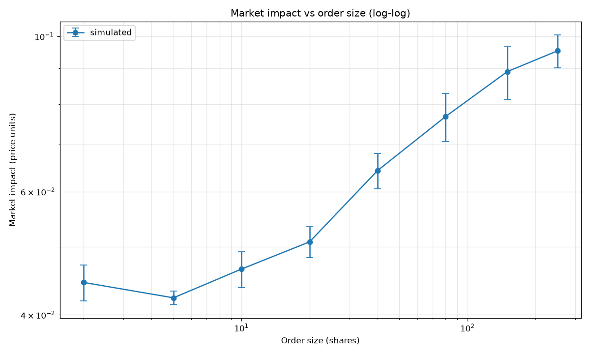

[](https://limit-order-book-o3becxbsbzmjlz2f5gln5a.streamlit.app/)

# Limit Order Book Simulator

Price-time priority matching engine with Poisson-driven order flow and
market impact analysis. Built from scratch: no external LOB libraries.

## What this is

A continuous double auction exchange simulator. Orders arrive randomly
(limit and market), match against resting liquidity in a price-time
priority book, and produce trades. The analysis extracts market quality
metrics — spread, depth, slippage — and measures **market impact** as a
function of order size.

## Key components

| Module | Purpose |
|---|---|
| `src/order.py` | Order dataclass: side, qty, price, type, timestamp, ID |
| `src/book.py` | Two-sided book: `{price → FIFO queue}` per side |
| `src/engine.py` | Matching engine: sweeps across levels, logs trades |
| `src/simulator.py` | Poisson arrival model with random cancels |
| `src/metrics.py` | Spread, depth, trade stats, impact curve |

## Market impact

The headline result. Market impact — the difference between average
execution price and pre-trade mid — grows **concavely** with order size.
This is the most robust empirical regularity in market microstructure.



**Fit:** power-law `impact ∝ size^0.15`. The textbook √-law predicts
exponent 0.5. Our sim gives 0.15 because the book is deeper than real
equity markets — a 250-share order fills inside a single price level.
Calibrating book depth to real SPY L2 data would bring the exponent
closer to the empirical value.

The lesson: getting an exponent ≠ 0.5 is a **calibration observation**,
not a bug. Real microstructure models are extremely sensitive to book
depth relative to typical order size.

## Features

### Price-time priority matching
- Orders at better prices fill first.
- Within a price level, FIFO — first order in, first order out.
- Trades print at the **passive** order's price (standard exchange convention).

### Market order behavior
- Sweeps the book across levels until filled or exhausted.
- Partial fill remainder is **discarded** (no resting), matching real exchange rules.

### Limit order behavior
- Matches while crossing the spread.
- Remainder rests in the book.

### Order flow
- Poisson arrivals with configurable rate for orders and cancels.
- Orders mix: 20% market, 80% limit (configurable).
- Limit prices: exponential offsets from mid — most near the touch, a few far.
- Quantities: exponential distribution with mean 5.

## Test suite

24 tests covering:
- Order validation (invalid qty, missing limit price)
- Book add/cancel/best bid/ask/spread
- FIFO priority within a level
- Price priority across levels
- Engine: market orders, partial fills, multi-level sweeps
- Simulator: reproducibility, no crossed book, valid trades

```bash
pytest -q     # all tests pass
```

## Project structure

```
limit-order-book/
├── src/
│   ├── order.py       # Order dataclass
│   ├── book.py        # Price levels + FIFO queues
│   ├── engine.py      # Matching engine + trade log
│   ├── simulator.py   # Poisson order flow
│   └── metrics.py     # Market quality + impact
├── tests/
├── notebooks/
│   └── impact_analysis.ipynb
├── results/
│   ├── impact_curve.png
│   └── impact_fit.png
├── app.py             # Streamlit dashboard
└── requirements.txt
```

## Run locally

```bash
pip install -r requirements.txt
pytest -q
streamlit run app.py
```

Or open `notebooks/impact_analysis.ipynb` for the analysis walkthrough.

## Limitations and next steps

- **Simplified order flow** — real order flow is more complex: correlated
  buy/sell pressure, transient impact, order clustering. Our Poisson model
  is the simplest possible.
- **No queue position modeling** — a resting order's fill probability
  depends on its position in the queue and on cancellations ahead of it.
  We track FIFO but not expected fill time.
- **No latency or adverse selection** — market makers in real markets lose
  money to informed traders; we don't model this.
- **Single symbol** — no cross-asset correlation.
- **Flat tick size** — real exchanges have variable tick sizes across price
  ranges.

Natural extensions:

- **Queue-reactive model** — arrival rates that depend on book imbalance
  (empirically observed, Huang-Lehalle-Rosenbaum 2015).
- **C++ port** — the current Python is ~1000 orders/sec; C++ would hit
  millions. The algorithm is identical; only the implementation changes.
- **Transient impact** — model how impact decays after a large trade.
- **Calibration to real L2 data** — take a day of SPY book snapshots,
  fit book depth and order arrival rates, and see if the impact curve
  matches reality.

## Skills demonstrated

- **Market microstructure** — order book mechanics, matching, price-time priority
- **Stochastic simulation** — Poisson processes, exponential distributions
- **Software design** — dataclasses, enums, modular architecture
- **Testing** — 24 tests including edge cases (empty book, partial fill, FIFO)
- **Data analysis** — impact curves, power-law fitting, log-log regression
- **Visualization** — matplotlib, Plotly, Streamlit dashboard